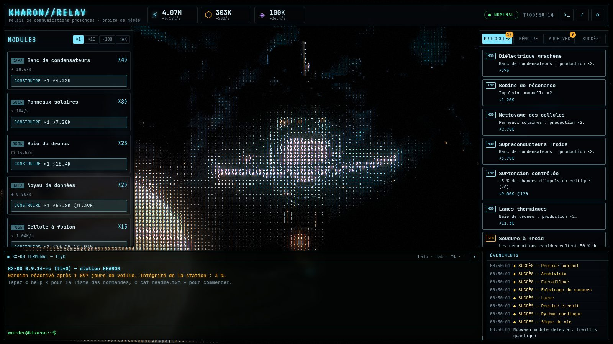
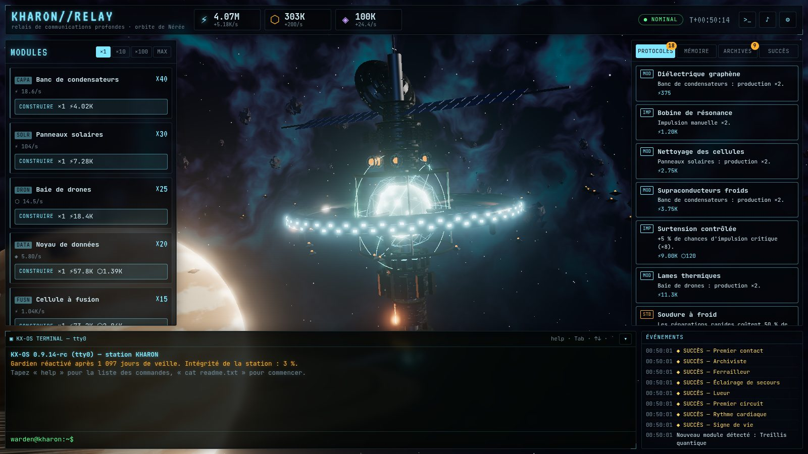
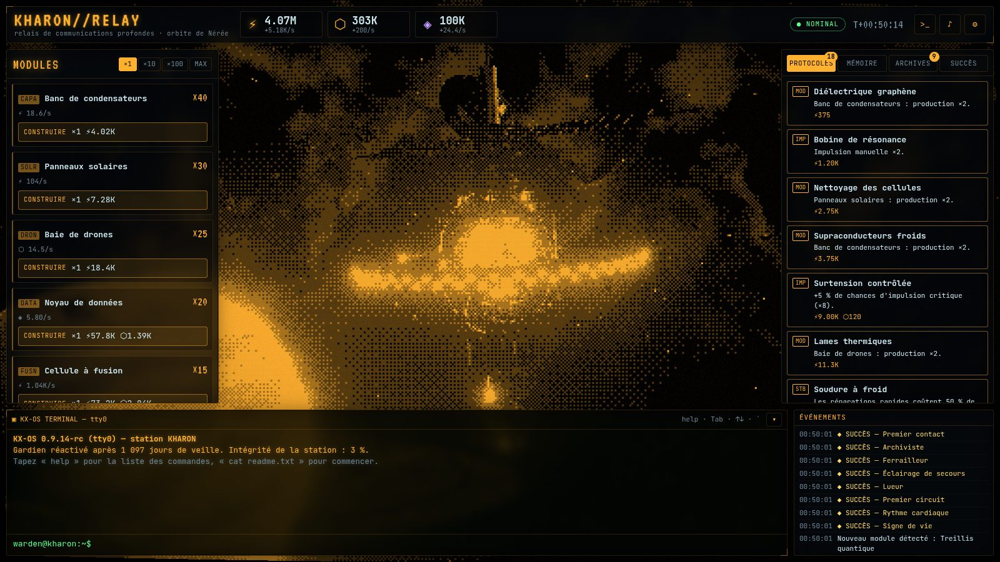
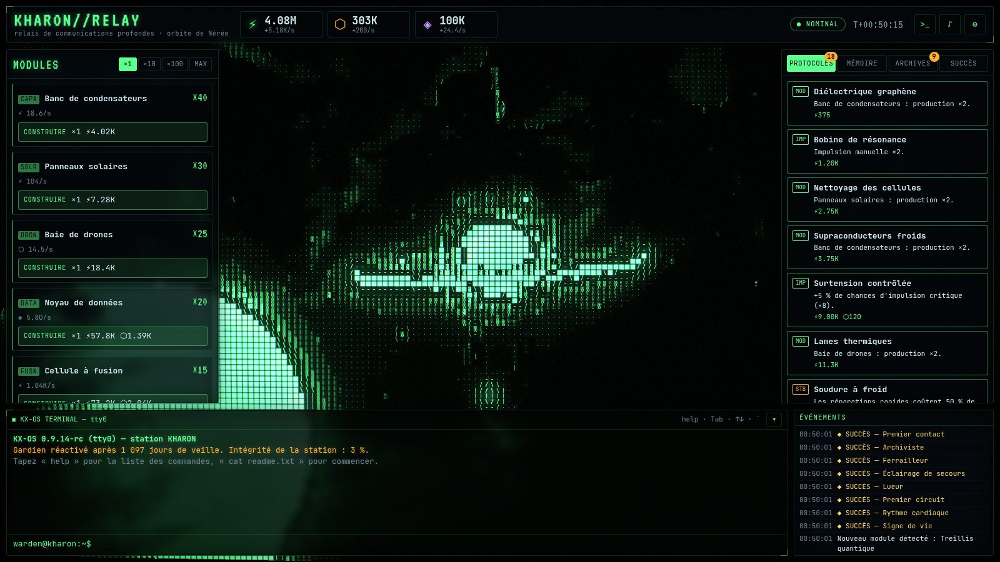
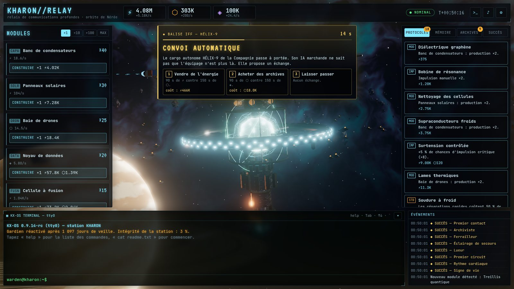
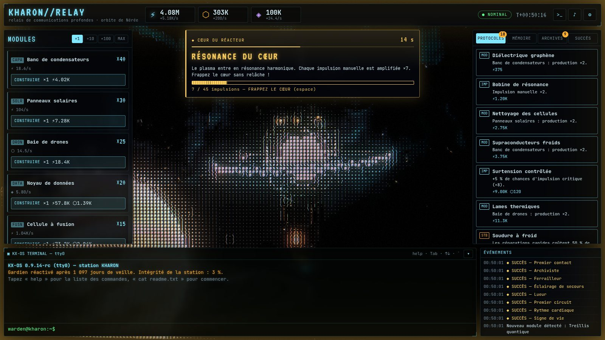
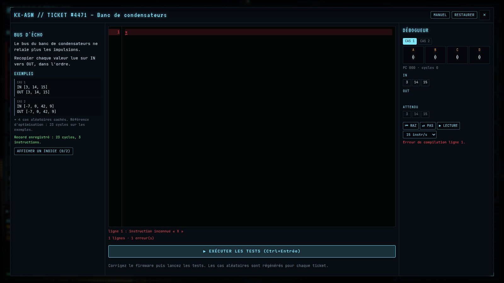
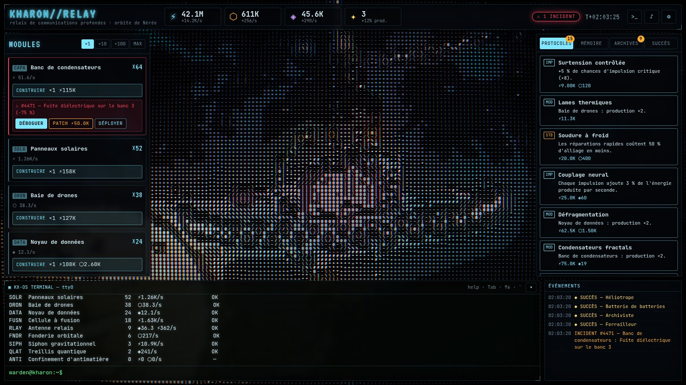

# KHARON//RELAY

> _Le relais est silencieux depuis 1 097 jours. Vous êtes le Gardien._

**KHARON//RELAY** est un jeu incrémental (clicker) en 3D qui se déroule sur une station de communications abandonnée, en orbite autour de la géante gazeuse Nérée. Vous incarnez **WARDEN**, l'intelligence de maintenance réveillée dans une station vide. Votre travail : rallumer le réacteur, restaurer les sous-systèmes, **réparer les firmwares en assembleur** et comprendre ce qui est arrivé aux sept membres d'équipage.

La 3D (Three.js) passe par une chaîne de post-traitement rétro : rendu **ASCII** avec contours orientés par Sobel, **tramage Bayer 1-bit**, **CRT** (courbure, lignes de balayage, aberration chromatique, glitchs d'incident).



|             Rendu net              |              Tramage ambre              |                 Phosphore + blocs                  |
| :--------------------------------: | :-------------------------------------: | :------------------------------------------------: |
|  |  |  |

|        Événement : convoi automatique        |           Événement : résonance du cœur            |
| :------------------------------------------: | :------------------------------------------------: |
|  |  |

|       Éditeur KX-ASM + débogueur        |               Terminal KX-OS               |
| :-------------------------------------: | :----------------------------------------: |
|  |  |

---

## Fonctionnalités

- **Clicker 3D** : cliquez sur le cœur du réacteur (shader de plasma déformé par bruit simplex) pour générer de l'énergie. La station se construit visuellement à mesure que vous achetez des modules : panneaux solaires, essaim de drones, baies de serveurs, cellules à fusion, antenne relais, siphon gravitationnel braqué sur Nérée, treillis quantique, confinement d'antimatière.
- **10 sous-systèmes**, **3 ressources** (énergie, alliage, données), **plus de 60 protocoles** (améliorations), **35 succès** et un système de **prestige** (redémarrage à froid, fragments mémoire, perks permanents).
- **Événements de station** : éruption stellaire, pluie de micrométéorites, tempête sur Nérée, cargo marchand, transmission fantôme, épave dérivante, résonance du cœur, chute de tension. Chaque alerte impose un choix avant la fin d'un compte à rebours (ou un objectif d'impulsions), avec sa mise en scène 3D, sa lueur d'écran et ses sons. Les gains et les coûts suivent votre production : un événement compte autant en début qu'en fin de partie.
- **Incidents et programmation** : les modules tombent en panne. Réparez-les gratuitement en écrivant un vrai programme en **KX-ASM**, l'assembleur original de la station (4 registres, flux IN/OUT, sauts conditionnels). Vous disposez d'un éditeur avec coloration syntaxique, d'un **débogueur pas à pas** (registres, pointeur d'instruction, flux comparés à l'attendu) et d'un banc de test. Les cas de test sont générés aléatoirement, donc une solution doit être correcte en général : impossible de coder les réponses en dur. Les firmwares validés sont réutilisables (`deploy`) et un démon peut les déployer automatiquement.
- **Terminal KX-OS complet** : système de fichiers virtuel reflétant l'état de la station (`/logs`, `/sys/modules`, `/firmware`, `/tickets`, `/signal`), une trentaine de commandes (`ls`, `cat`, `tree`, `grep`, `hexdump`, `repair`, `patch`, `build`, `install`, `decrypt`, `scan`, `top`, `sysinfo`…), autocomplétion Tab, historique, et quelques secrets.
- **Récit** : 15 journaux de bord, dont certains chiffrés ou cachés, révèlent un mystère qui se termine en boucle. Le dernier ticket de programmation décode le signal lui-même.
- **Fond 3D procédural** : nébuleuse en fBm, champ d'étoiles scintillantes et filantes, géante gazeuse avec bandes à _domain warping_ et œil de tempête pulsant (et ses éclairs), anneaux, ceinture de débris instanciés, paquets de données dérivants à intercepter.
- **Audio 100 % synthétisé** (WebAudio) : nappe de coque, souffle de ventilation, craquements, bips lointains, alarmes et effets.
- **Modèles 3D Meshy AI** optionnels via un pipeline reproductible, plafonné en crédits.
- Sauvegarde automatique avec copie de secours, export/import par code, **progression hors-ligne**, réglages persistés (filtre, palette, glyphes, qualité, audio, mouvements réduits).

## Démarrage rapide

### Avec Docker (recommandé)

```bash
docker compose up -d --build
# → http://localhost:8080
```

Le conteneur sert le jeu en statique avec nginx :

- utilisateur non-root, système de fichiers en lecture seule, aucune capacité Linux ;
- CSP stricte, compression gzip, cache immuable des assets ;
- sonde de santé sur `/healthz`.

Port personnalisé : `KHARON_PORT=3000 docker compose up -d`. Derrière un reverse proxy local (Caddy, Traefik, nginx avec TLS), utilisez `KHARON_BIND=127.0.0.1` pour ne pas exposer le port directement.

Sans compose :

```bash
docker build -t kharon-relay .
docker run -d -p 8080:8080 --read-only --tmpfs /tmp --cap-drop ALL kharon-relay
```

La CI publie aussi l'image sur GitHub Container Registry à chaque push sur `main` : `ghcr.io/<propriétaire>/kharon-relay:latest`.

### En développement

Prérequis : Node.js ≥ 22.

```bash
npm install
npm run dev        # http://localhost:5173
```

| Commande                             | Rôle                                                        |
| ------------------------------------ | ----------------------------------------------------------- |
| `npm run build`                      | vérification de types + bundle de production dans `dist/`   |
| `npm run preview`                    | sert le build sur http://localhost:4173                     |
| `npm test` / `npm run test:coverage` | tests unitaires (Vitest), couverture du noyau ≥ 80 % exigée |
| `npm run test:e2e`                   | tests de bout en bout Playwright sur le build               |
| `npm run check`                      | lint + types + tests avec couverture                        |
| `npm run assets:meshy:plan`          | estimation des crédits Meshy (aucun appel réseau)           |

## Comment jouer

| Action                                 | Contrôle                                             |
| -------------------------------------- | ---------------------------------------------------- |
| Impulsion manuelle                     | clic sur le cœur du réacteur, ou **barre d'espace**  |
| Tourner / zoomer la caméra             | glisser / molette                                    |
| Ouvrir le terminal                     | **`** (ou ²)                                         |
| Répondre à un événement de station     | clic sur la carte d'alerte, ou touches **1** à **3** |
| Éditeur : lancer les tests / pas à pas | **Ctrl+Entrée** / **F10**                            |

1. Générez de l'énergie, construisez un **banc de condensateurs**, puis les modules suivants.
2. Quand un **incident** survient, le module perd une partie de sa production. Trois options :
   - **DÉBOGUER** : écrire le firmware en KX-ASM. C'est gratuit, et la production est multipliée par 1,5 pendant 10 minutes ;
   - **PATCH** : payer une réparation rapide ;
   - **DÉPLOYER** : réutiliser un firmware déjà écrit.
3. Installez des **protocoles**, lisez les **archives**, interceptez les **paquets dérivants**.
4. Répondez aux **événements de station** (à partir de 5 minutes de jeu) : récolter une pluie de météores au risque d'une panne, commercer avec un cargo, répondre à une voix qui n'aurait pas dû parler… Les phénomènes du cœur (résonance, chute de tension) se jouent en frappant le réacteur. Une alerte dangereuse ignorée a des conséquences.
5. Au-delà de 100 M d'énergie produite dans le cycle, un **redémarrage à froid** rapporte des fragments mémoire permanents.

### KX-ASM en 30 secondes

```asm
; Recopie le flux d'entrée en doublant chaque valeur
boucle:
  JEOF fin        ; plus rien à lire ?
  MOV A, IN       ; lit une valeur
  ADD A, A
  MOV OUT, A      ; l'écrit en sortie
  JMP boucle
fin:
```

Instructions : `MOV ADD SUB MUL DIV MOD INC DEC NEG SWP JMP JZ JNZ JGZ JLZ JEOF NOP HLT`. Le manuel complet est dans le jeu (`man kxasm`) et dans [docs/KX-ASM.md](docs/KX-ASM.md).

## Modèles 3D Meshy AI (optionnel)

La station est entièrement procédurale. Le script `scripts/meshy/generate.mjs` peut y ajouter des modèles générés par [Meshy](https://www.meshy.ai) (text-to-3D) : module de commande, drones, parabole, débris, conteneurs, sonde abandonnée.

```bash
cp .env.example .env          # renseigner MESHY_API_KEY (plan Meshy payant requis pour l'API)
npm run assets:meshy:plan     # affiche le plan : 6 assets, ~85 crédits
npm run assets:meshy          # génère, optimise (gltf-transform + meshopt) et met à jour public/models/manifest.json
```

- **Budget** : plafond de 100 crédits par défaut (`MESHY_BUDGET`). Le script refuse de démarrer si l'estimation, ajoutée aux crédits déjà dépensés, dépasse le plafond.
- **Reprise** : chaque tâche facturée est enregistrée dans `scripts/meshy/state.json` avant l'attente du résultat. Une interruption ne provoque jamais de seconde facturation. Committez ce fichier (il ne contient que des identifiants de tâches) pour garder cette protection sur d'autres machines.
- **Secret** : seules `MESHY_API_KEY` et `MESHY_BUDGET` sont lues depuis `.env`. La clé n'est jamais transmise aux sous-processus, comme l'optimiseur gltf-transform, qui est épinglé en version exacte.
- **Configuration** : prompts, modèles et densité de polygones se règlent dans `scripts/meshy/assets.json`.
- Le jeu charge les modèles listés dans le manifest et retombe sur la géométrie procédurale en leur absence.

## Architecture

```
src/
  core/        noyau de jeu PUR (aucun DOM, aucune dépendance à Three.js)
    data/      contenu : modules, protocoles, perks, succès, tickets KX-ASM, journaux
    asm/       analyseur, machine virtuelle et banc de test KX-ASM
    shell/     interpréteur du terminal et système de fichiers virtuel
    reducer.ts (état, action) → (nouvel état, événements), entièrement immuable
  game/        store, persistance localStorage, réglages (zod)
  render/      Three.js : scène, station, fond, effets, post-traitement (shaders GLSL)
  audio/       synthèse WebAudio
  ui/          interface DOM typée (sans framework), éditeur, débogueur, terminal
tests/         tests unitaires Vitest (noyau, pipeline Meshy)
e2e/           tests de bout en bout Playwright
scripts/meshy/ pipeline de génération d'assets 3D
deploy/        configuration nginx
```

Détails : [docs/ARCHITECTURE.md](docs/ARCHITECTURE.md) · Game design et équilibrage : [docs/GAME-DESIGN.md](docs/GAME-DESIGN.md).

## Qualité

- TypeScript strict (`noUncheckedIndexedAccess`), ESLint, Prettier.
- Près de 200 tests unitaires, couverture du noyau ≈ 98 % des lignes (seuil CI : 80 %), et 9 tests E2E.
- Chaque ticket KX-ASM a une solution de référence testée sur plusieurs graines, et son firmware corrompu de départ doit échouer.
- Tests E2E : démarrage sans erreur, construction, terminal, réparation d'un incident, refus d'un firmware faux, persistance, réponse à un événement, objectif d'impulsions.
- Les données externes (sauvegarde locale, code d'import, manifest des modèles, réglages) sont validées par schéma (zod) avant usage.
- CI GitHub Actions : lint, format, types, couverture, build, E2E, build Docker avec test de santé, publication GHCR.

## Licence

[MIT](LICENSE). Polices : JetBrains Mono et VT323 (SIL Open Font License, via Fontsource). Bruit simplex GLSL : Ashima Arts / Stefan Gustavson (MIT).
